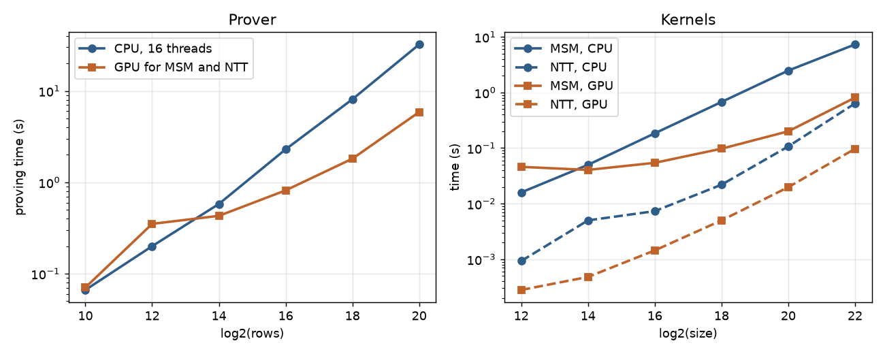

# Veil

A zero-knowledge proof system written from the field arithmetic up: PLONK with KZG
commitments over BLS12-381. The demo proves that you know the solution of a Sudoku
without showing it. The proof is 624 bytes, and three separate verifiers accept it:
Rust, a Solidity contract on Ethereum's BLS12-381 precompiles, and TypeScript in the
browser.

| part | language | what it does |
|---|---|---|
| `prover/` | Rust (standard library only) | Fq and Fr in Montgomery form, the Fq2/Fq6/Fq12 tower, G1 and G2, the optimal ate pairing, SHA-256 and Keccak, Pippenger MSM, the NTT, KZG, the EIP-4844 functions, and PLONK: preprocessing, the prover, the verifier, the Fiat-Shamir transcript. A CLI, and the generator of the Solidity verifier |
| `prover/cuda/` | CUDA | MSM (buckets sorted with CUB, one thread per bucket, a segmented reduction) and the NTT, on the CPU's own Montgomery layout. The prover uses them with `--gpu` |
| `lang/` | Haskell | **the Veil language** and its compiler `veilc`: functions, loops and arrays resolved at compile time, lowering to PLONK gates with two optimizations (lazy products and shared subexpressions), and the witness program |
| `evm/` | Solidity, TypeScript | the generated verifier contract, tested in an EVM (EthereumJS, Prague) with gas measurements |
| `web/` | TypeScript | the browser demo: the Rust prover compiled to Wasm runs in a worker; the verifier is a separate TypeScript implementation (BigInt) |
| `bench/` | Python | the benchmarks and the report |

## The Veil language

```
// x is one of lo..hi
def in_range(x, lo, hi) {
  let p = 1;
  for k in lo..hi + 1 { p = p * (x - k); }
  assert p == 0;
}

// 2^(x-1) for a digit x: the polynomial through (1, 1), (2, 2), ..., (9, 256)
def bit(x) { return interp(x, 1, [1, 2, 4, 8, 16, 32, 64, 128, 256]); }

circuit sudoku(public puzzle[81], private solution[81]) {
  for i in 0..81 {
    in_range(solution[i], 1, 9);
    assert puzzle[i] * (solution[i] - puzzle[i]) == 0;   // a given digit is kept
  }
  let bits = [bit(solution[i]) for i in 0..81];
  for k in 0..9 {
    assert sum([bits[9 * k + j] for j in 0..9]) == 511;    // row k
    ...
```

(The whole file: [`lang/examples/sudoku.veil`](lang/examples/sudoku.veil).) Nine digits from 1 to 9 are all different exactly when their powers of two sum to 511. This costs 15 gates per cell. Checking each pair with an inverse would cost 2 gates for each of the 972 pairs, and the circuit would no longer fit the ceremony's 4096 powers.

The compiler keeps every value as a linear combination, or one product plus a linear combination, until a gate is unavoidable. One PLONK gate holds `q_M a b + q_L a + q_R b + q_O c + q_C`. So `(x-1)(x-2) = 0`, `x y = z` and an assertion over three variables each cost one gate. Identical gates are shared. On the Sudoku this gives **1575 gates, against 3024 with `-O0`** (every product its own gate, nothing shared).

## Results

All numbers come from `bench/bench.py`. The full tables are in [`results/README.md`](results/README.md). Machine: Intel Core i7-10870H (8 cores, 16 threads) and an NVIDIA RTX 2060 (6 GB).

### Proof size and time

| | |
|---|---|
| proof | **624 bytes** (9 compressed G1 points, 6 scalars), the same for every circuit |
| Sudoku: 1575 gates + 81 public inputs, n = 2048, Ethereum ceremony SRS | preprocessing 0.09 s and proving 0.10 s native; 5.7 s in Wasm (one thread, preprocessing included) |
| verifying the Sudoku proof | 21 ms Rust, 163 ms TypeScript, 453k gas on the EVM (503k for the whole transaction, calldata included) |

Synthetic circuits that fill every row (local SRS):

| rows | prove, CPU (16 threads) | prove, CPU + CUDA | speedup | verify |
|---|---|---|---|---|
| 2^12 | 0.20 s | 0.35 s | 0.6x | 20 ms |
| 2^14 | 0.58 s | 0.43 s | 1.3x | 19 ms |
| 2^16 | 2.30 s | 0.82 s | 2.8x | 21 ms |
| 2^18 | 8.10 s | 1.81 s | 4.5x | 18 ms |
| 2^20 | 32.2 s | 5.88 s | 5.5x | 18 ms |

The kernels alone, CPU against GPU (copies included): MSM 3.4x at 2^16, 12.4x at 2^20 (2.48 s against 0.20 s), 9.1x at 2^22. NTT 5.1x at 2^16, 5.4x at 2^20. Below 2^14 points the GPU MSM loses to the CPU (46 ms against 16 ms at 2^12, mostly fixed costs), so the GPU does not help small circuits.



The verifier's cost does not depend on the circuit: two Miller loops and one MSM of 18 points. On the GPU, the prover still computes the quotient's numerator and the linearization on the CPU. That is why the speedup is smaller than the kernels'.

### Official test vectors

`scripts/fetch_vectors.py` downloads them. They are data only, pinned by hash and commit. All of them pass:

- **ethereum/bls12-381-tests v0.1.2**: the G1 and G2 deserialization vectors (26). They cover flags, infinity, x at or above p, points off the curve, and points outside the subgroup.
- **The EIP-4844 KZG vectors** from c-kzg-4844: `blob_to_kzg_commitment` (11), `compute_kzg_proof` (52), `verify_kzg_proof` (122), `compute_blob_kzg_proof` (15), `verify_blob_kzg_proof` (29), `verify_blob_kzg_proof_batch` (24), `compute_challenge` (9). Every case passes, including the invalid inputs. They run against **the Ethereum KZG ceremony's trusted setup**, which is also the SRS of the Sudoku proofs, so they test the curve arithmetic, the pairing, the MSM and KZG on real data.

The vectors that need hash-to-curve (BLS signatures, `hash_to_G2`) are not used: hash-to-curve is not implemented. PLONK does not need it.

### Soundness tests

A proof system that accepts too much would still pass tests made only of honest proofs, so most tests try to cheat:

- **Rust** (`prover/tests/plonk.rs`):
  - each of the 15 proof elements is changed (a point moved by G or swapped with another, an evaluation plus one), and each change is rejected;
  - wrong, missing or extra public inputs are rejected;
  - a witness that breaks one multiplication gate and nothing else is rejected;
  - a witness where every gate holds but one copy constraint is broken (a variable used with two values) is rejected;
  - a point on the curve outside the order-r subgroup is rejected, and so is a scalar of r or more;
  - a proof replayed against a circuit that differs in one gate is rejected;
  - 200 random bit flips are all rejected, either when parsing or by the verifier.
- **Solidity** (`evm/`): the contract rejects every changed point and evaluation, another puzzle, a public input of r or more, and a short proof.
- **TypeScript** (`web/`): the TypeScript verifier rejects changed points, a changed evaluation and another puzzle. The Wasm prover refuses a wrong solution.
- **The compiler** (`lang/test/`): wrong solutions fail the gates. The checked cases are a changed given, a repeated digit, and digits outside 1..9. 300 random expressions, compiled with and without optimization, agree with direct evaluation mod r, and a wrong output fails.

All three verifiers check the same proofs: the Rust CLI's proof passes in TypeScript and in the EVM, and the Wasm prover's proof passes in TypeScript.

## How it works

- **Arithmetic.** Montgomery multiplication (CIOS) on 64-bit limbs on the CPU and 32-bit limbs on the GPU. The Montgomery form is the same (R = 2^384 and 2^256), so buffers cross unchanged. The pairing is written for clarity: an affine Miller loop on the twist, lines mapped into Fq12 through the untwisting map, the easy part of the final exponentiation with one Frobenius, and the hard part as a plain square-and-multiply.
- **PLONK** follows Gabizon, Williamson and Ciobotaru (2019): the linearization polynomial with r(ζ) = 0, two opening proofs and one pairing check. Wire polynomials, z and the quotient are blinded. The quotient (degree 3n+5) is computed on a coset of size 4n, which is enough because only its values have to be exact. Public inputs take the first rows, so the transcript and the PI polynomial agree.
- **Fiat-Shamir** uses Keccak-256: the state starts as `keccak256("veil-plonk-v1" ‖ verifying key)` and absorbs the public inputs and every commitment. Points are absorbed in their 128-byte EIP-2537 encoding, the bytes the Solidity verifier hashes straight from calldata.
- **On-chain.** `veil export-sol` writes a contract with the verifying key as constants. It uses the precompiles G1MSM (0x0c), PAIRING_CHECK (0x0f) and MODEXP. The precompiles check that every point is canonical, on the curve and in the subgroup. The proof crosses as 1344 bytes, uncompressed, because the EVM has no point decompression.
- **CUDA MSM.** The windows are 15 or 17 bits wide, which divides 255. A short last window would send every point to a few buckets and serialize them on one thread: with 13-bit windows an MSM of 2^16 points took 0.38 s, against 0.05 s now. Bucket indices are sorted with CUB, each bucket is accumulated by one thread, and each window's running sum is split into 256 segments.

## Limits

- **Not audited, not constant time.** The field arithmetic branches on values, so the prover may leak through timing. Use Veil for learning and measurement, not to protect secrets.
- **The SRS.** The Sudoku uses the Ethereum KZG ceremony, which has 4096 powers. That allows circuits up to n = 2048 (the prover needs n + 6 powers). The benchmarks go further with a local SRS from a known τ (`insecure:`); anyone can forge proofs against it.
- **CUDA is tested on this machine only** (`cargo test --features cuda`, plus `gpu_matches_cpu` in every benchmark), not in CI: GitHub's runners have no GPU.
- The Wasm prover runs on one thread.
- The demo's Sudoku circuit trusts that the public puzzle has digits from 0 to 9. A verifier that wants to rule out a nonsensical puzzle checks the 81 public values itself.

## Building and running

```bash
python scripts/fetch_vectors.py                       # test vectors and the ceremony setup into data/
(cd prover && cargo test --release)                   # Rust: 20 unit tests, 5 vector suites, 10 PLONK soundness tests
(cd prover && cargo test --release --features cuda)   # with nvcc and an NVIDIA GPU
(cd lang && mkdir -p build && ghc -O1 -isrc -itest -outputdir build/test -o build/spec test/Spec.hs && ./build/spec)
scripts/sudoku.sh                                     # compile, prove, verify, Solidity, the browser's files
(cd evm && npm ci && npm test)                        # the Solidity verifier in the EVM
(cd web && npm ci && npm test && npm run build && npm run serve)   # then http://localhost:8000
python bench/bench.py                                 # after: cd prover && cargo build --release --features cuda
```

The CLI: `veil prove --circuit C --inputs I --srs ceremony:data/trusted_setup.txt`, `veil verify --vk vk.bin --proof proof.bin --public public.txt`, `veil export-sol`, `veil bench --log-n K [--gpu]`.

## License

MIT
