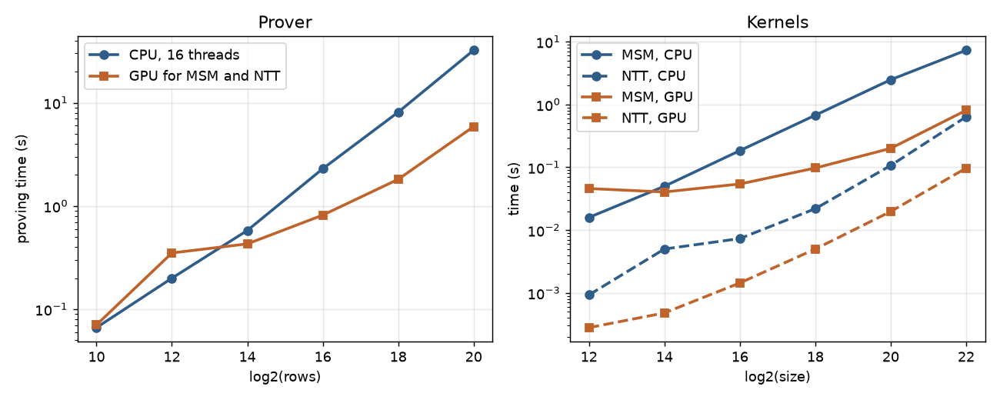

# Veil: measured results

Generated by `bench/bench.py` on an Intel Core i7-10870H (16 threads) and an NVIDIA GeForce RTX 2060 (6 GB).

## Sudoku (the demo)

The circuit `lang/examples/sudoku.veil`: 1575 gates (3024 without the compiler's optimizations), 1656 rows with the 81 public inputs, domain n = 2048, SRS from the Ethereum KZG ceremony.

| step | time |
|---|---|
| preprocessing (native, CPU) | 91 ms |
| proving (native, CPU) | 97 ms |
| proving in Wasm (Node, one thread, preprocessing included) | 5700 ms |
| verifying (Rust) | 21.0 ms |
| verifying (TypeScript, BigInt) | 163 ms |

## On-chain verification (EVM, EIP-2537 precompiles)

| measure | value |
|---|---|
| execution gas | 452,753 |
| calldata gas (4,068 bytes: the 1344-byte proof, 81 public inputs, ABI) | 29,364 |
| transaction total (+21,000) | 503,117 |
| deployed bytecode | 6,124 bytes |

## Prover on synthetic circuits

All rows used (2^k - 3 gates, 2 public inputs, one equality), insecure local SRS. The proof is always 624 bytes.

| rows | preprocessing CPU | prove CPU | preprocessing GPU | prove GPU | speedup | verify |
|---|---|---|---|---|---|---|
| 2^10 | 0.07 s | 0.07 s | 0.06 s | 0.07 s | 0.9x | 19.6 ms |
| 2^12 | 0.21 s | 0.20 s | 0.51 s | 0.35 s | 0.6x | 19.7 ms |
| 2^14 | 0.55 s | 0.58 s | 0.61 s | 0.43 s | 1.3x | 18.6 ms |
| 2^16 | 1.90 s | 2.30 s | 1.07 s | 0.82 s | 2.8x | 20.7 ms |
| 2^18 | 7.79 s | 8.10 s | 1.96 s | 1.81 s | 4.5x | 17.5 ms |
| 2^20 | 31.84 s | 32.23 s | 6.60 s | 5.88 s | 5.5x | 17.8 ms |

## Kernels (G1 MSM, Fr NTT)

| size | MSM CPU | MSM GPU | speedup | NTT CPU | NTT GPU | speedup |
|---|---|---|---|---|---|---|
| 2^12 | 15.9 ms | 45.9 ms | 0.3x | 0.93 ms | 0.28 ms | 3.3x |
| 2^14 | 49.9 ms | 40.5 ms | 1.2x | 5.00 ms | 0.48 ms | 10.4x |
| 2^16 | 184.2 ms | 54.2 ms | 3.4x | 7.33 ms | 1.44 ms | 5.1x |
| 2^18 | 674.9 ms | 97.3 ms | 6.9x | 21.90 ms | 4.99 ms | 4.4x |
| 2^20 | 2478.1 ms | 200.1 ms | 12.4x | 106.95 ms | 19.76 ms | 5.4x |
| 2^22 | 7315.2 ms | 807.7 ms | 9.1x | 636.07 ms | 96.93 ms | 6.6x |

GPU times include the copies between host and device. Every GPU result was compared with the CPU's (`gpu_matches_cpu`: all true).

